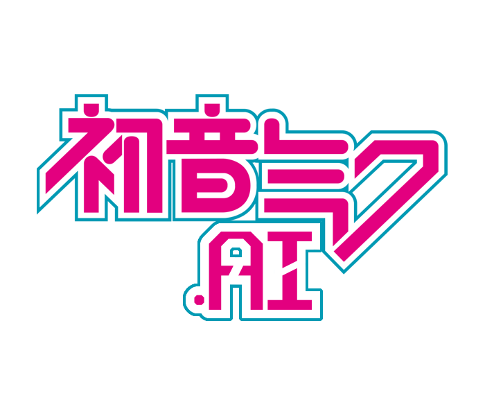
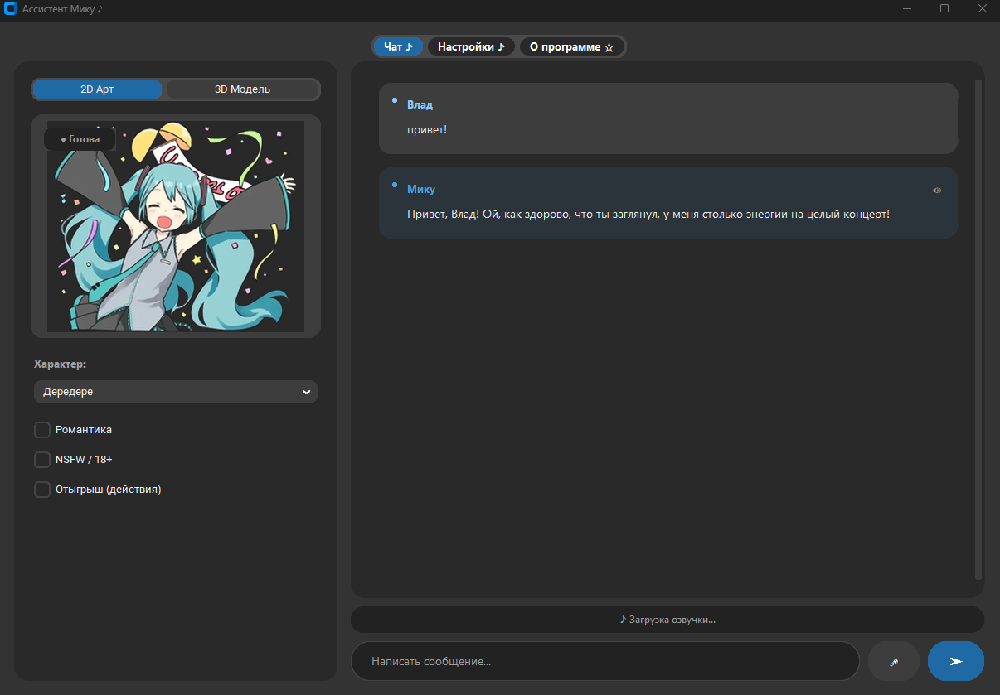
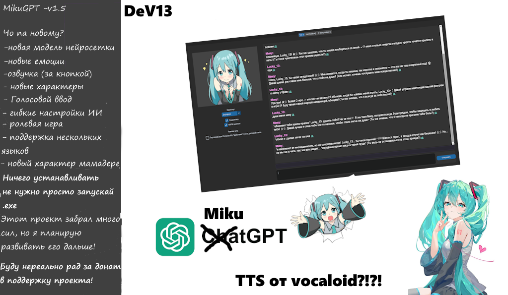
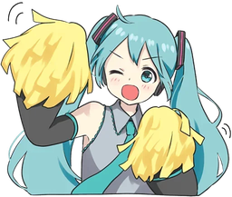
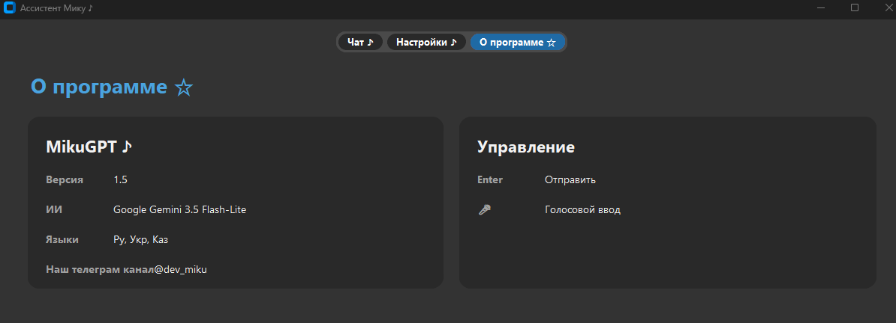

<div align="center">

<a href="https://github.com/vlad-abobus/MikuGPT0">
  
</a>

### Не ассистент. Собеседница.

Десктопный ИИ-компаньон с Хацунэ Мику: характер, эмоции и голос в одном приложении.

<p>
  <a href="https://github.com/vlad-abobus/MikuGPT0/releases/download/lol/main.exe">
    
  </a>
  <a href="https://t.me/dev_miku">
    
  </a>
  <a href="https://github.com/vlad-abobus/MikuGPT0">
    
  </a>
</p>

<sub><a href="https://vlad-abobus.github.io/MikuGPT0/">Сайт проекта</a> · Windows 10 / 11 · x64 · версия 1.5 · open source</sub>

</div>

<p align="center">
  <a href="screen.PNG">
    
  </a>
  <br>
  <sub>Интерфейс MikuGPT · версия 1.5</sub>
</p>

---

## О проекте

**MikuGPT** — это Мику, которая живёт на твоём компьютере. Она помнит, что ты любишь, меняет выражение лица прямо во время разговора и говорит своим голосом — без браузера и лишних вкладок.

Проект бесплатный и открытый: история, память и настройки остаются локально, а для работы нужен только собственный ключ Google Gemini.

<div align="center">
  
  <br>
  <em>«Не спеши. Я никуда не денусь — просто напиши „привет“.»</em>
</div>

## Возможности

| | Возможность | Что это даёт |
|:--:|:--|:--|
| 🎭 | **Живые эмоции** | 40+ реакций и три набора — A, B и C. Портрет меняется прямо по ходу ответа, а не после перезапуска. |
| 🎙️ | **Голос и слух** | Fish Audio: Мику говорит, а текст реплики появляется синхронно с её голосом. Голосовой ввод превращает речь в сообщение. |
| 🧠 | **Smart Memory** | Имя, интересы и важные мелочи остаются в контексте. Диалог автоматически конспектируется каждые несколько сообщений. |
| 💬 | **Шесть характеров** | Дередере, Цундере, Дандере, Яндере, Агрессивная и Уку-Мамадере — один голос, но разный тон. |
| 🎪 | **Ролеплей** | Описывай действия звёздочками — получай ответ в формате *действие* + реплика, как в Character.AI. |
| 💕 | **Романтика и NSFW** | Режимы общения переключаются в настройках одной галочкой. |
| 🔒 | **Приватность** | История, память и настройки хранятся на компьютере, а ключи — в локальном `.env`. Для озвучки текст отправляется в Fish Audio. |
| 🌙 | **Тёмный интерфейс** | Спокойный GUI на CustomTkinter: чат, эмоции, голос и настройки в одном окне. |

## Шесть способов быть рядом

- **Дередере** — солнечный ураган. Всегда в восторге от общения, заряжает энергией и не даёт унывать.
- **Цундере** — ворчит и вредничает, но внимание, спрятанное за колкостями, замечаешь сразу.
- **Дандере** — тихая и застенчивая. Говорит мало, зато каждое слово — искреннее.
- **Яндере** — любит до самозабвения. Никогда не отпустит и обязательно напомнит об этом.
- **Агрессивная** — дерзкая, громкая и острая на язык. Провоцирует, спорит, но скучать не даёт.
- **Уку-Мамадере** — окутает заботой, напомнит про шапку и чай. Уютная гавань в одном окне.

## Эмоции

<p align="center">
  
  
  
  
</p>

<p align="center">
  <sub>Уверенность · Смущение · Радость · Сонливость</sub>
</p>

В приложении 64 реакции в трёх наборах. Набор C — самый большой: 40 портретов, которые меняются вместе с настроением Мику.

## Интерфейс

Вся служебная часть спрятана в настройках и справке. На экране остаётся главное: Мику, диалог и тонкая настройка характера.

<p align="center">
  <a href="screen2.PNG">
    
  </a>
  <br>
  <sub>Экран «О программе» · версия 1.5</sub>
</p>

## Технологии

| Компонент | Реализация |
|:--|:--|
| Интерфейс | Python 3.10+ и CustomTkinter |
| Модель | Google Gemini 3.5 Flash-Lite |
| Голос | Fish Audio (облако, модель `s2.1-pro-free`) |
| Ввод | Текст и распознавание речи |
| Платформа | Windows 10 / 11, x64 |
| Языки | Русский, украинский, казахский |

---

## Установка

> [!IMPORTANT]
> Для работы нужны два ключа: [Google AI Studio](https://aistudio.google.com/apikey) для ответов и [Fish Audio](https://fish.audio/app/developers) для озвучки. Оба хранятся в `.env` рядом с приложением.

### Готовая сборка

1. Скачай [`main.exe`](https://github.com/vlad-abobus/MikuGPT0/releases/download/lol/main.exe) из последнего релиза. Другие версии — в [релизах](https://github.com/vlad-abobus/MikuGPT0/releases).
2. Создай рядом с приложением файл `.env` и заполни ключи:

   ```ini
   GEMINI_API_KEY=твой_ключ
   FISH_API_KEY=твой_ключ
   FISH_REFERENCE_ID=603c98f4bbca4e7aaca410231ed6b144
   FISH_TTS_MODEL=s2.1-pro-free
   ```

   `FISH_REFERENCE_ID` — это голос Мику. Его можно заменить на ID своего голоса с `fish.audio/m/<id>`.
   Старый `api_gem.txt` всё ещё поддерживается как запасной вариант для Gemini, но `.env` приоритетнее.

3. Запусти `main.exe`, выбери характер и поздоровайся.

### Из исходного кода

```bash
git clone https://github.com/vlad-abobus/MikuGPT0.git
cd MikuGPT0

python -m venv venv
.\venv\Scripts\Activate.ps1

pip install -r requirements.txt

# Скопируй шаблон и заполни GEMINI_API_KEY и FISH_API_KEY:
cp .env.example .env
python main.py
```

Для Linux / macOS активация окружения выглядит так: `source venv/bin/activate`.

## Управление

| Элемент / клавиша | Действие |
|:--|:--|
| `Enter` | Отправить сообщение |
| `Shift + Enter` | Перенести строку |
| 🎤 | Включить голосовой ввод |
| 🎭 | Выбрать набор эмоций (A / B / C) |
| 💕 | Включить режим романтики |
| 🔞 | Включить NSFW-режим |

## Структура проекта

<details>
<summary><b>Посмотреть основные файлы</b></summary>

```text
MikuGPT0/
├── main.py              # GUI (CustomTkinter) и основная логика
├── ai_chat.py           # Единая точка вызова LLM
├── gemini_client.py     # Google Gemini API
├── prompts.py           # Системные промпты и характеры
├── emotions.json        # Эмоции: наборы A / B / C
├── emotions_data.py     # Загрузка и подготовка эмоций
├── fish_tts.py          # Озвучка: Fish Audio API
├── audio_player.py      # Воспроизведение аудио и события панды
├── speech_stream.py     # Синхронная потоковая озвучка ответа
├── voice_input.py       # Распознавание речи
├── paths.py             # Работа с путями и загрузка .env
├── app_logging.py       # Логирование
├── config.json          # Пользовательские настройки
├── requirements.txt     # Зависимости Python
├── .env.example         # Шаблон ключей (скопируй в .env)
├── .env                 # Локальные ключи (в .gitignore)
├── api_gem.txt          # Старый ключ Gemini, запасной вариант (в .gitignore)
├── build_exe.bat        # Сборка PyInstaller
├── icon.ico             # Иконка приложения
├── LLK.png              # Мику для README
├── logotitlemikuai.png  # Логотип проекта
├── screen.PNG           # Скриншот интерфейса
├── screen2.PNG          # Экран «О программе»
├── index.html           # Лендинг проекта
├── styles.css           # Стили лендинга
├── site.js              # Интерактив лендинга
├── emotions/
│   ├── A/               # 15 эмоций (PNG)
│   ├── B/               # 9 эмоций (JPG)
│   └── C/               # 40 эмоций (PNG)
└── models/              # 3D-модели панды
```

</details>

---

## Поддержать проект

Проект был и остаётся бесплатным. Если хочется сказать спасибо — помощь идёт на развитие и оплату API:

<p>
  <a href="https://send.monobank.ua/jar/HTxkQ2n5w">
    
  </a>
</p>

Новости и обновления — в Telegram: [@dev_miku](https://t.me/dev_miku).

## Авторы

| Роль | Участник |
|:--|:--|
| 🎨 **Идея, арт, эмоции** | **Lucky_13** |
| 🛠️ **Код, архитектура, промпты** | **VladislavMorgan** |
| 👥 **Тестирование и фидбек** | **Community LK_13** |

## Лицензия

Проект распространяется под лицензией **MIT**. С текстом лицензии можно ознакомиться [здесь](https://opensource.org/license/mit).

---

<div align="center">
  
  <br>
  <sub>Сделано с любовью для LK_13 · Hatsune Miku © Crypton Future Media</sub>
</div>
